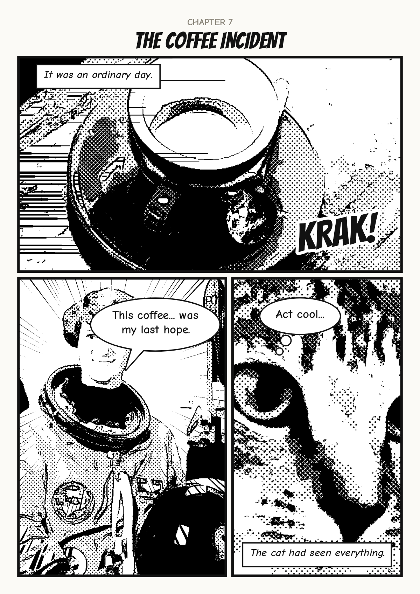

<p align="center">
  
</p>

# Koma

**Your days, drawn as manga.** Pick or shoot photos and Koma inks them into black-and-white manga pages, with panels, screentone, speech bubbles and sound effects. Everything runs on the phone's GPU; no photo ever leaves the device.

<p align="center">
  
</p>

## What it does

- **Photo to manga.** Each photo is flattened, outlined with ink lines and shaded with halftone dots and hatching. Tone thresholds come from the photo's own histogram, so dark and bright shots both come out readable.
- **Subject cut-out (Android).** Koma finds the person, animal or object in each photo on the device. A panel's background can then be kept, cleared to white or filled black, and focus and speed lines are drawn behind the subject and centred on it.
- **Page layouts.** 19 layouts for one to six panels. Tap **Layout** to cycle through the ones that fit your photo count.
- **Multi-page chapters.** A chapter can hold up to 12 pages. Start one with up to 12 photos and Koma spreads them over as few pages as fit, or tap **New page** to add one after the current page. Step between pages with the arrows above the page; reorder or delete a page under **Page style**. The title sits on the first page and later pages are numbered.
- **Read mode.** Tap **Read** in the editor to read the chapter full screen, one page at a time. Swipe or tap the edges of the screen to turn pages, and tap the middle to show or hide the controls. Pages turn left to right by default; switch to right to left, as printed manga does, and Koma remembers the choice.
- **Page style.** Per page: gutter (tight, normal, wide), panel border (none, thin, normal, bold), white or black paper, and bleed, where panels run to the edge of the paper. **Use this style on every page** copies it to the whole chapter.
- **Dark mode.** The app follows the system's light or dark theme. Pages themselves always look the same.
- **Per-panel control.** Tone (light, medium, heavy), line strength (none, soft, bold), and focus or speed lines. Drag inside a panel to reframe the photo and pinch to zoom in, up to 3×. **Move earlier** and **Move later** swap a photo with its neighbour.
- **Words.** Speech bubbles, shouts in a jagged burst, whispers in a dashed balloon, thought bubbles, captions and SFX. Drag them anywhere, edit the text, pick one of four sizes, flip a balloon's tail to either side, run an SFX down the panel letter by letter, duplicate one, or shuffle from a built-in word bank that follows the page's mood (action, drama, calm, comedy).
- **Emotion marks.** Sweat drops, the popping anger vein, sparkles, hearts, shock lines and gloom lines. Drag a mark next to a face, size it, tilt it or mirror it; it gets a white halo so it reads over dark tone.
- **Camera or library.** Take a photo on the spot or choose from your photos, when starting a page and when adding or replacing a panel.
- **Undo and redo.** Every edit can be stepped back, including removed panels and deleted text.
- **Chapters.** Every chapter gets a number and a title, and is kept in a library on the device. Long-press a chapter to delete it.
- **Export.** Renders each page as a 1600 × 2262 PNG. Save all of them to your photos in order, or share the page on screen.

## Install on Android

Build a release APK and install it over USB:

```bash
npm install
npx expo prebuild --platform android
cd android && ./gradlew assembleRelease
adb install -r app/build/outputs/apk/release/app-release.apk
```

The APK lands in `android/app/build/outputs/apk/release/`. It is signed with the debug keystore, which is fine for sideloading but not for the Play Store.

## Development

Koma uses native modules (Skia), so it needs a development build and does not run in Expo Go.

```bash
npm install
npx expo run:android   # or: npx expo run:ios
```

Before committing:

```bash
npx expo lint
npx tsc --noEmit
```

The `android/` and `ios/` folders are generated by `expo prebuild` and are not checked in. Configure native behaviour in `app.json`.

## How the manga look works

The pipeline lives in `src/manga/` and is written as two SkSL shaders run through [React Native Skia](https://shopify.github.io/react-native-skia/):

1. **Decode and downscale** the photo to at most 1100 px on its long side.
2. **Flatten** with a Kuwahara filter. This removes photo texture such as noise and soft gradients while keeping edges sharp, so areas read as painted.
3. **Measure** the grey histogram on a 96 × 96 copy and derive percentile-based tone thresholds.
4. **Ink.** An XDoG edge pass draws the lines, then three tone levels are filled in: dots, dots with hatching, and solid black. Focus and speed lines are drawn only on blank paper so the subject stays clear.

On Android a fifth input joins step 4: a subject mask made by ML Kit's subject segmentation, through the small Kotlin module in `modules/koma-subject/`. Google Play services downloads the model, so the first photos after a fresh install may have no mask yet; those panels are drawn as before and the Background control stays hidden.

Steps 1 to 3 and the mask run once per photo and are cached. Step 4 is cheap and reruns whenever a panel's settings change.

## Project layout

```
src/
  app/            Expo Router screens
    index.tsx       library of pages
    page/[id].tsx   page editor
    read/[id].tsx   full-screen chapter reader
  manga/          photo -> manga pipeline (shaders, tone maths)
  page/           page model, layouts, drawing, storage, photo picking, export
  words/          word bank for titles, bubbles, captions and SFX
  ui/             shared controls
  theme.ts        colours, spacing, fonts
modules/
  koma-subject/   Android native module: subject mask with ML Kit
tools/
  shader-harness/ run the shaders on the desktop
  page-harness/   render a whole page on the desktop
```

Chapters are stored in the app's document folder as `pages/<id>/`, holding `page.json`, copies of the source photos, and the last exported `page.png` (first page) plus `page-2.png` and so on. Chapters saved before multi-page support are upgraded when they are loaded.

## Desktop harnesses

Both harnesses exist so the look can be tuned without a phone.

Run the manga shaders on a single image (CPU, so it takes tens of seconds):

```bash
npm run harness -- <in.png> <out.png> [ink 0..1] [fx 0|1|2] [mask.png] [bg 0|1|2]
npm run harness -- tools/shader-harness/samples/cat.png tools/shader-harness/out/cat.png 0.5 1
```

Render a full page from already-inked images:

```bash
npx tsx --tsconfig tools/page-harness/tsconfig.json tools/page-harness/render.tsx <out.png> <layout-id> <img1.png> [img2.png ...]
```

Layout ids are listed in `src/page/layouts.ts`, for example `3-top` or `6-grid`. Set `FRAME` to a JSON page style (for example `FRAME='{"border":"bold","dark":true}'`) and `SHEET=1` to draw a later page without the title.

## Stack

Expo SDK 58, React Native 0.88, Expo Router, React Native Skia, TypeScript.

## License

MIT. See [LICENSE](LICENSE).
